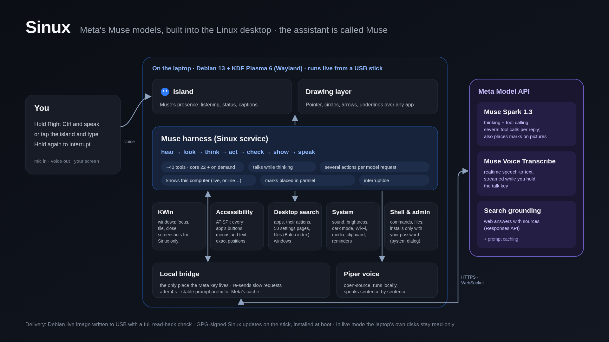

# Sinux

**A Linux desktop with an AI assistant built into the operating system.** The assistant, **Muse**, is part of the
desktop itself, not a chatbot in a window: hold **Right Ctrl** and talk, and Muse sees what you see, explains any app
by drawing on the real screen, and gets things done across the whole desktop. Its thinking and hearing come from
**Meta's Muse models through the Meta Model API**; everything that connects them to the desktop is Sinux's own code.

Built for the **Meta Global AI Developer Hackathon** (November 2026).



## What Muse does

- **Talks** — push-to-talk with Meta Muse Voice Transcribe (realtime); answers spoken sentence by sentence with a
  local Piper voice; hold the key again to interrupt.
- **Shows** — pointer, circles, boxes, underlines, highlights and arrows drawn above every window: exactly on app
  controls (Linux accessibility, AT-SPI), on words in any app's text, and on parts of pictures (Muse Spark finds them
  on a zoomed crop).
- **Acts** — windows through KWin, app controls by name, a KRunner-style search over apps, ~50 System Settings
  pages, files and windows; sound, brightness, dark mode, Wi-Fi, media; files and shell; installs software only
  through the system's own password dialog.
- **Knows its environment** — live USB or installed, online or behind a Wi-Fi login page, what is selected or under
  the mouse ("explain this").

## Meta models used

| Model / API | Role |
| --- | --- |
| **Muse Spark 1.3** (tool calling) | The brain: ~40 desktop tools (22 always on, the rest loaded on demand); several tool calls per reply; precise visual locator on zoomed crops |
| **Muse Voice Transcribe 1.0** (realtime) | Speech input, streamed while the talk key is held |
| **Search grounding** (Responses API) | Web answers with sources |
| Prompt caching | Stable prompt prefix; plus parallel work and re-sending slow requests to keep it responsive |

## Run it

You need a **Meta Model API key** (dev.meta.ai) and a computer with **Debian 13 and KDE Plasma 6 (Wayland)** — an
installed system, or the official [Debian 13 KDE live image](https://www.debian.org/CD/live/) booted from a USB stick.

1. Download `sinux-agent_0.2.0_amd64.deb` from this repository's **Releases**.
2. Install it (needs the internet for its dependencies):
   ```bash
   sudo apt install ./sinux-agent_0.2.0_amd64.deb
   sudo usermod -aG input $USER     # talk key and virtual keyboard/pointer
   ```
3. Log out and back in. The **Muse** island appears at the top of the screen.
4. Click the island → **Settings** → paste your Meta API key → **Connect**.
5. Hold **Right Ctrl**, speak, release. Try: *"How are you built into this laptop?"*, *"Show me how to make a new
   folder in Dolphin"*, *"Turn on dark mode"*, *"Open Firefox and search for Meta Muse Spark."*

**Our USB stick:** for the demo we booted a Debian 13 KDE live image remastered with this package
(`desktop/live/build.py`, `prepare-live.sh`), written by `write_usb.py` with a full read-back check, and updated
from the stick with GPG-signed packages (`updates.py`). In that live session the laptop's own disks stay read-only.
Rebuilding the package or image is included for transparency: `build_agent.py` also expects the Piper voice
`en_US-lessac-medium` and the base image's package list under `output/` (not in this repository).

## Code map

| Path | What it is |
| --- | --- |
| `desktop/agent/agent.py` | The agent loop: context → Muse Spark with tools → act → verify → show and speak |
| `desktop/agent/tools.py`, `native.py` | Windows (KWin scripting), screenshots (KWin ScreenShot2), virtual input (uinput), files, shell |
| `desktop/agent/elements.py` | App controls and text through accessibility (AT-SPI), exact positions |
| `desktop/agent/discover.py`, `system.py`, `environment.py` | Desktop search, system controls, facts about this computer |
| `desktop/agent/service.py`, `*.qml`, `Ink.mjs` | The island, drawing overlay and Settings (Qt Quick, layer-shell) |
| `desktop/providers/meta/` | Local bridge that alone holds the key (`chat_bridge.py`), realtime voice and Piper (`voice.py`) |
| `desktop/live/` | Package build, live image remaster, verified USB writer, signed updates |

## Privacy and safety

The Meta key stays in a local bridge process (saved only if you choose "Remember"). Screenshots go to Meta only when
a request is about the screen; the clipboard only when you mention it. Administrator changes need your password.
Acting and the shell can be turned off in Settings.

## Limits

Needs the internet for thinking and hearing; each model step takes a few seconds; some pop-up menus are invisible to
accessibility (vision fallback); no memory between sessions yet; English voice; tested on one laptop.

## Credits and licence

Sinux's own code is GPL-3.0 (see `LICENSE`). Built on KDE Plasma, KWin and Debian; uses Qt/PyQt6, Piper TTS
(`en_US-lessac-medium` voice) and [perfect-freehand](desktop/presentation/upstream/perfect-freehand) (MIT, licence
included). The wallpaper is original artwork made for this project.
